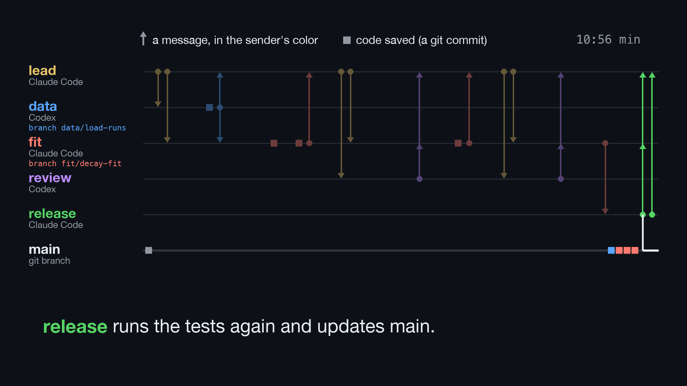

# MAP demo: a team of agents builds a decay fit

A reproducible demo of the [Multi-Agent Protocol](https://github.com/gao-xh/multi-agent-protocol)
(MAP): a lead and four other sessions build a small data-analysis feature together, in
plain git. One command replays the whole story in a fresh directory:

```sh
git clone https://github.com/gao-xh/map-demo
cd map-demo
demo/replay.sh            # add --pause to stop after each step
```

It needs `git` and [uv](https://docs.astral.sh/uv/), and takes about a minute (most of it is
installing numpy and scipy once).

[](docs/runs/2026-10-29-real-agents.mp4)

A real run with Claude Code and Codex, as a 75-second video. Every arrow is a message on
the coordination branch, in the sender's color.

https://github.com/user-attachments/assets/3dd7fc8b-3a6b-4d9c-9ed3-26bc05d11cc6

<details>
<summary>Chinese version (中文版)</summary>

https://github.com/user-attachments/assets/a0283c93-604e-49ec-8a53-b35d3cb21e5f

</details>

## The story

| Step | Session | What happens |
| --- | --- | --- |
| 1 | owner | starts the project: synthetic sample runs and an empty package |
| 2 | lead (Claude Code) | installs MAP, writes the role table into `AGENTS.md`, creates the `coordination` branch |
| 3 | lead | hands the loader to line `data` and the fit to line `fit` |
| 4 | data (Codex) | claims the task, builds `load_runs`, runs its tests, pushes `data/loader` |
| 5 | fit | starts early and tries data's task: the claim is refused (exit 1) |
| 6 | data | hands the loader to `fit` with the exact commit and the tests it ran |
| 7 | fit (Claude Code) | claims the fit and starts on data's commit |
| 8 | fit | runs out of context: pushes a WIP commit and leaves a `transfer` handover |
| 9 | fit (Codex, another machine) | reads the transfer, checks the branch SHA, finishes the fit and its tests |
| 10 | lead, review | the lead asks an agent that did not build it to review that exact commit; the review goes back to the lead and fit |
| 11 | fit | asks for the release |
| 12 | release | reruns the tests on that commit, fast-forwards `main` and reports `released` to fit and the lead |
| 13 | release, you | the tag waits for you: release asks, you answer (`--pause` lets you type it), release records it with `decide.sh` and tags `v0.1.0` |
| 14 | lead | `doctor.sh` checks the coordination branch: 0 errors, 0 warnings |

The agents are simulated: every action is a fixed shell command in
[`demo/replay.sh`](demo/replay.sh), so the run is the same every time. The commits on the
development branches get the same SHAs on every machine; coordination messages carry the
real time of the run, so their names differ. With real agents, each session follows the
same steps from `AGENTS.md` and the MAP scripts.

After a run, everything stays in the work directory the script prints: the shared remote
`origin.git` and one clone per session (`lead/`, `data/`, `fit/`, `fit-laptop/`,
`review/`, `release/`). Read the messages with
`git -C <work>/lead show origin/coordination:messages/<name>`.

## With real agents

`demo/real-agents/run.sh` tells the same story with real sessions instead of fixed
commands: Codex as line `data` and as the reviewer, Claude Code as line `fit`, the lead and
the release role. It sets up the project with `demo/replay.sh --setup-only`, then starts
each session once, unattended, in its own clone, with the prompts in
`demo/real-agents/prompts/`; each one reads its inbox and acts on its own.

```sh
demo/real-agents/run.sh        # needs claude and codex, logged in; uses model credits
```

Every run differs, takes about 10 to 15 minutes, and spends model usage. The agents run with
their tools allowed inside the work directory (Claude Code: file tools plus only `git`, the MAP
scripts and `uv run --locked`; Codex: `workspace-write` with the clone's `.git` writable
and no network), so run it only in a throwaway
directory. Each agent's output is kept in `<work>/logs/`. The release session does not tag:
the tag waits for the owner, as `AGENTS.md` says.

### A real run

[`docs/runs/2026-10-29-real-agents.html`](docs/runs/2026-10-29-real-agents.html) is the
timeline of one real run (about 11 minutes, no human input; download it and open it in a
browser), [`docs/runs/2026-10-29-real-agents.mp4`](docs/runs/2026-10-29-real-agents.mp4)
the same run as a short video, and
[`docs/runs/2026-10-29-real-agents.bundle`](docs/runs/2026-10-29-real-agents.bundle) its
shared remote as a git bundle, with every message and commit
(`git clone --mirror docs/runs/2026-10-29-real-agents.bundle run.git`). Codex, as the reviewer, found that Claude Code's fit failed when the time axis
did not start at zero (P2); Claude Code fixed it, Codex approved the new commit, and the
release session fast-forwarded `main` and stopped before the tag, which waits for the
owner.

### A timeline of a run

```sh
uv run python demo/timeline.py <work directory>     # writes <work directory>/timeline.html
```

One self-contained HTML page (light and dark) with every message, claim, status change and
commit of the run in order, with the agent tool of each line and the full text of each
message. Commits the replay made on its fixed clock are listed first and marked.

## The example project

`decay-fit` fits exponential decay times, with one-sigma uncertainties, to measurement runs:

```sh
uv run decay-fit data/sample
uv run pytest -q
```

```
run               tau (s)        amplitude  chi2/dof
run-01      2.048 ± 0.039    0.990 ± 0.012      0.98
run-02      3.535 ± 0.066    0.789 ± 0.010      1.15
run-03      5.080 ± 0.054    1.195 ± 0.009      1.06
```

The sample runs are synthetic, written by `scripts/make_sample_data.py` with a fixed seed
(true decay times 2.0, 3.5 and 5.0 s), so the tests can check the fit against the truth.

## Files

- `demo/replay.sh`: the replay; `--map DIR` uses a local MAP checkout instead of cloning
  the public repository at `v2.0.0` (`MAP_TAG`). The demo stays on MAP 2.0.0 on purpose:
  the replay installs MAP into the project, so another version changes the commit SHAs
  that the MAP README quotes. The parts of the protocol the demo shows are the same in 2.1.
- `demo/files/AGENTS.md`: the rules the lead writes, with the role table
- `demo/files/project-README.md`: the README of the replayed project
- `src/`, `tests/`, `data/sample/`, `scripts/`: the finished example project, which the
  replay adds step by step

License: MIT.
